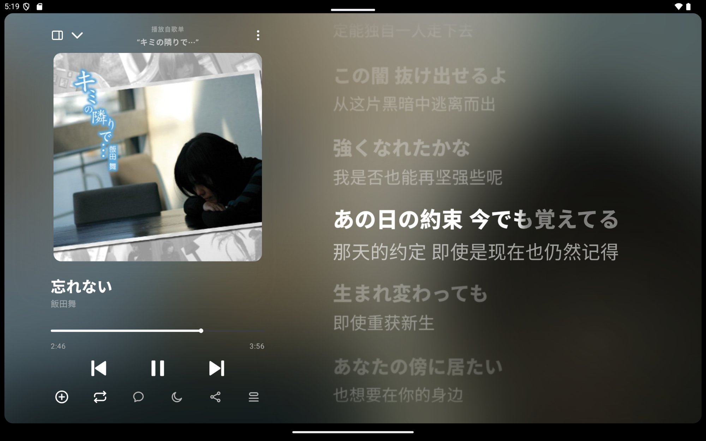
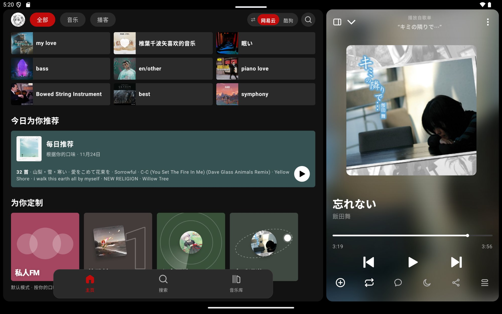

# 平板类 Apple Music 播放页 1.1.0

需要 API 1.12 Android 宿主。

| 平板宽屏 | 平板侧栏 |
|---|---|
|  |  |

- 背景：`background/mist.js` 按设计稿 CSS 复刻：拿 `state.cover`（需 `canvasCover: true`）放大 1.4 倍，`blur(6% 宽) saturate(1.6) brightness(.75)`，叠两个取自调色板的径向光晕与 18% 黑色遮罩；浅色主题整体提亮。结果缓存到离屏画布，只在封面、尺寸或配色变化时重画。
- `ui/wide.json`：平板侧栏铺开到全屏时的左栏。自定义顶栏（收起、播放来源、更多），大圆角封面带调色板主色投影（暂停时缩小、双击收藏），歌名、歌手，进度条，三个无底色大控制键，底部收藏、播放模式、评论、定时、分享、播放列表。右栏只显示歌词，加大留白、限制最大宽度。
- `ui/player.json`：竖屏同一套排版，点小歌词打开歌词页。
- `ui/lyrics.json`：全屏歌词页使用同一背景；歌词白色（深色）/深灰（浅色），左对齐、当前行放大、其余行按距离模糊。宽屏右栏的歌词颜色与样式也读取这里。
- `ui/mini.json`：迷你播放器使用封面底色到高亮色的横向渐变。

构建：`python package.py`（校验布局并打包）；检查：`node test-background.cjs`。
导入 `mist-player.melodiaplugin` 后，在「设置 → 扩展 → 插件 → 播放器布局」里给各区域选择本插件。停用插件即可恢复内置外观。
